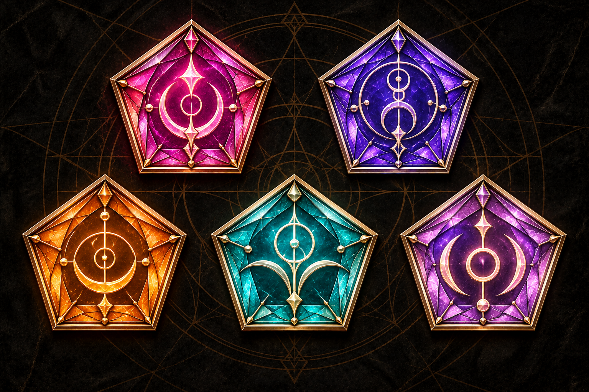

<div align="center">

# THE MIRRORS

### Restore the glass. Imprison the wizard. Become the hero.

**A gothic fantasy board game for 2–5 players, brought to life in your browser.**

[Get started](#get-started) · [How to play](#how-to-play) · [Development](#development) · [Rules & design](#rules--design)



**35 rooms · 155 cards · One shattered prison**

</div>

---

## Enter the Mirror Castle

A dare at the Drunken Pony leads a band of adventurers into an abandoned manor. Beneath its central Hall lies the broken kaleidoscopic prison of **Occuldor**, a wizard of mirrors and illusions. To seal him away again, the heroes must explore the castle, place White and Black Mirrors, survive their collisions, and restore all **35 fragments**.

The Mirrors is an original game by **Filip Kochoski**, adapted here as a playable, local hot-seat browser game. It combines cooperation with personal ambition: everyone needs the prison restored, but the most heroic surviving player claims victory.

## Inside the game

| Feature | What you can do |
| --- | --- |
| **Explore the castle** | Navigate 35 connected rooms with Courage-based movement, discoveries, tokens, and paired Portals. |
| **Place & Collide** | Combine accessible White and Black Mirrors, reveal discoveries, lure Occuldor away, and resolve Black Mirror curses. |
| **Restore the Kaleidoscope** | Choose pentagonal cells, connect colored fragments, and earn Courage from neighboring pieces and completed gems. |
| **Build your character** | Manage Mirrors, Elements, Equipment, Tools, Relics, Companions, and four unlockable Spell slots. |
| **Learn & cast Spells** | Pay with carried or room Elements, assign matching Sigils, and choose Quick or Permanent effects. |
| **Complete private Secrets** | Inspect hidden achievements and reveal them when their conditions are met. |
| **Finish an expedition** | Save locally, resume between sessions, and reach victory or defeat with a final player ranking. |

The catalog includes **35 White Mirrors, 35 Black Mirrors, 25 Items, 35 Spells, 10 Companions, and 15 Secrets**. Original card IDs and source definitions are retained, with designer-approved revisions applied through explicit adapters.

## Get started

Requires **Node.js 22.12 or newer** and **pnpm**. Node.js 24 has been used for development.

```sh
git clone https://github.com/filip-kocho/The-Mirrors.git
cd The-Mirrors
npm install -g pnpm
pnpm install
pnpm dev
```

Open **[localhost:3000](http://localhost:3000)**, start a new expedition, and choose 2–5 heroes.

Dependencies require internet access to install. Local gameplay needs no account, backend, or external asset service. Players take turns on the same browser; this is not online multiplayer.

For a production build:

```sh
pnpm build
pnpm start
```

## How to play

1. **Explore.** Move to a room using your hero's Courage-based allowance. Only your destination is entered and discovered.
2. **Prepare a pair.** In a room with an unrestored Sigil, place one White and one Black Mirror from your board and/or the room. The White Mirror reveals all its discoveries. Occuldor arrives and guards the Black Mirror.
3. **Lure Occuldor away.** Place another pair elsewhere to free the previously guarded pair.
4. **Collide.** Return to an unguarded pair, activate its Black Mirror curse, and receive the room's Sigil. Occuldor's Rage increases.
5. **Restore the glass.** Click a legal Kaleidoscope cell. The first piece starts at the border; later pieces must touch existing glass. Every neighboring fragment contributes a Courage bonus.
6. **Grow stronger.** Collect Sigils to unlock Knowledge slots, learn Spells, use Items, and reveal completed Secret achievements.
7. **Seal the prison.** Restore all 35 fragments before every hero falls. Surviving heroes are ranked at the end.

Click objects to inspect their cards. Click the center of the Hall to enlarge the Kaleidoscope. The in-game **How to Play** explains the controls and rules in more detail.

### Saving your expedition

Successful game commands save progress in this browser, and the Save control is also available. Resume restores the expedition, including pending choices. Saves are browser-local: they do not sync through GitHub or between devices. Clearing browser storage removes them.

Hot-seat privacy hides private information during handovers; it is not a security boundary against someone inspecting browser storage.

## Current development status

This is an actively developed, playable adaptation. The core loop, endgame, 35 revised Black Mirror curses, 25 Item abilities, 15 Secret achievements, and all **70 Quick/Permanent Spell configurations** have engine implementations.

Some designer decisions remain deliberately configurable or unresolved:

- **15 Spells have obsolete Tool prerequisites** and remain blocked from learning until replacement requirements are approved.
- Companion attachment, following, and selected conflicts are implemented; additional individual behaviors remain provisional.
- Balance, selected edge cases, and playtest defaults are tracked explicitly in the design documents.

See the coverage reports below for the exact limits; implemented does not mean final or fully balanced.

## Development

Built with **Next.js App Router, React, strict TypeScript, Tailwind CSS, Zustand, and Zod**. Authoritative game rules live in a pure TypeScript engine, separate from the React interface. Seeded setup makes game generation reproducible.

```sh
pnpm typecheck                     # TypeScript validation
pnpm test                          # Vitest engine and component tests
pnpm exec playwright install chromium
pnpm test:e2e                      # Browser interaction tests
pnpm build                         # Production compilation
```

### Project layout

```text
app/                 Application routes and global styling
src/components/      Game table, character boards, cards, and dialogs
src/game/            Domain engine, card adapters, systems, maps, and setup
src/stores/          Client game state
public/icons/        Supplied game artwork
reference/           Original catalogs and revised designer specifications
tests/               Engine, component, and browser tests
docs/                Rules status, implementation reports, and design decisions
```

## Rules & design

- [Rules status](docs/RULES_STATUS.md) — confirmed, provisional, and outstanding mechanics
- [Open design decisions](docs/OPEN_DESIGN_DECISIONS.md) — unresolved questions and playtest defaults
- [Card implementation coverage](docs/CARD_IMPLEMENTATION_STATUS.md)
- [Black Mirror implementation](docs/BLACK_MIRROR_IMPLEMENTATION.md)
- [Item implementation](docs/ITEM_IMPLEMENTATION.md)
- [Secret achievements](docs/SECRET_IMPLEMENTATION.md)
- [Spell implementation v0.4](docs/SPELL_IMPLEMENTATION_v0.4.md)
- [Architecture](docs/ARCHITECTURE.md)
- [Changelog](docs/CHANGELOG.md)

The original game, supplied artwork, and card catalogs are part of this project's creative source material. This repository does not currently include an open-source license.
